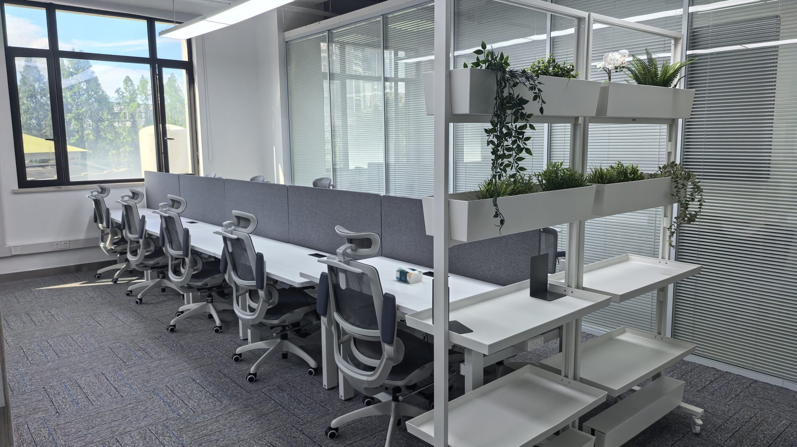

## Office Location

**Zeju Li, PhD**  
College of Biomedical Engineering  
Fudan University  
Room C2008, No. 2 Interdisciplinary Research Building  
Jiangwan Campus, Fudan University  
Shanghai, China

## Contact Information

**Email:** zejuli@fudan.edu.cn  
**Office Hours:** Monday-Friday, 9am-5pm

## Mailing Address

Same as office location.

## Directions {#directions}

::: {.panel-tabset}

### Campus Overview

::: {.location-card}
::: {.location-header}
## Jiangwan Campus, Fudan University
:::

::: {.location-content}
The Jiangwan Campus is located in the northeastern part of Shanghai, featuring modern research facilities and a beautiful academic environment.

{width=1200px}

**Getting Here:**

- **Metro:** Take Line 10 to Guofan Road Station (国帆路) – Exit 3 (3号口)
- **Address:**  2005 Songhu Road, Yangpu District, Shanghai (Enter at Gate 2 / 2号门)
:::
:::

### Building Location

::: {.location-card}
::: {.location-header}
## No. 2 Interdisciplinary Research Building
:::

::: {.location-content}
Our building houses cutting-edge research facilities and collaborative spaces for interdisciplinary research.

{width=1200px}

**Building Features:**

- Modern research laboratories
- Collaborative meeting spaces
- Advanced equipment facilities
- Secure access control
:::
:::

### Lab Space

::: {.location-card}
::: {.location-header}
## Room C2008 - Biomedical Engineering Lab
:::

::: {.location-content}
Our dedicated research space where innovation meets collaboration.

{width=1200px}

**Lab Features:**

- State-of-the-art research equipment
- Collaborative workspace
- Data analysis stations
- Meeting area for team discussions
:::
:::

:::

## Social Media & Professional Networks

- **University Website:** [Fudan-BME](https://bme-college.fudan.edu.cn/lzj/main.htm)
- **Twitter/X:** [@li_zeju](https://twitter.com/li_zeju)
- **LinkedIn:** [LinkedIn](https://www.linkedin.com/in/zeju-li-a42676102/)
- **Github:** [Github](https://github.com/ZerojumpLine/)
- **Google Scholar:** [Zeju Li](https://scholar.google.co.uk/citations?user=zeuflXEAAAAJ&hl=en&oi=ao)
- **ORCID:** [0000-0002-4608-2959](https://orcid.org/0000-0002-4608-2959)