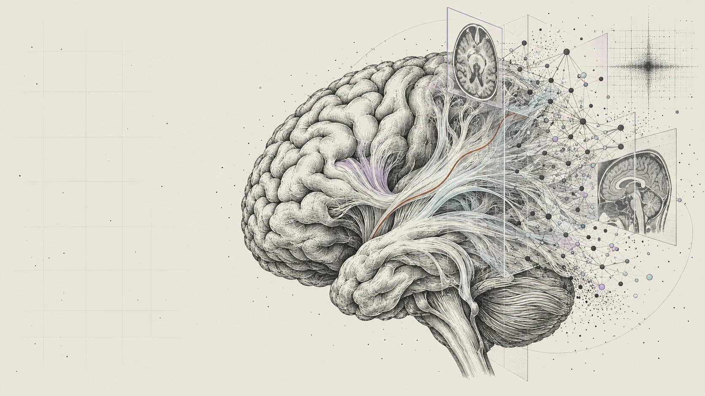
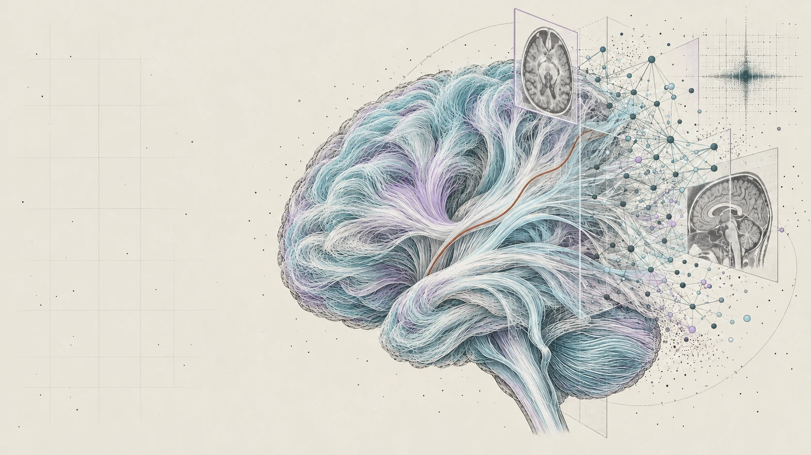
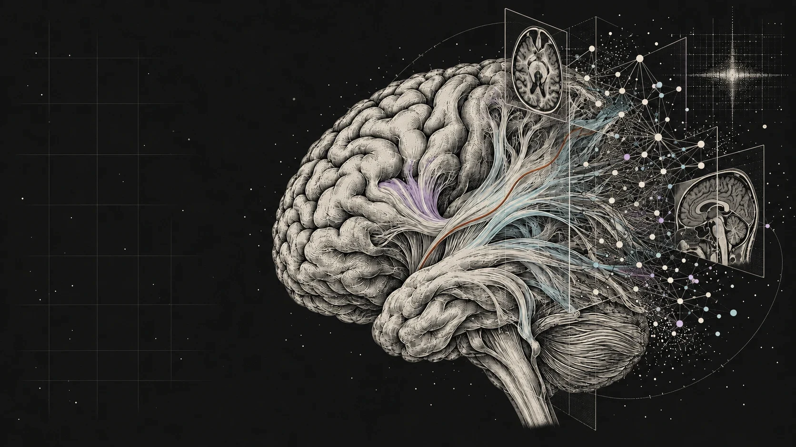
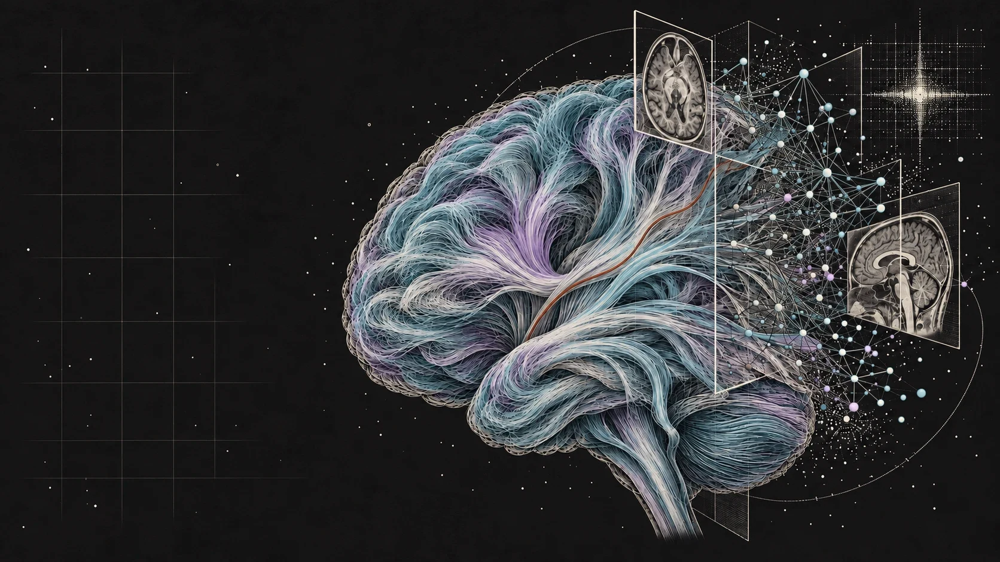
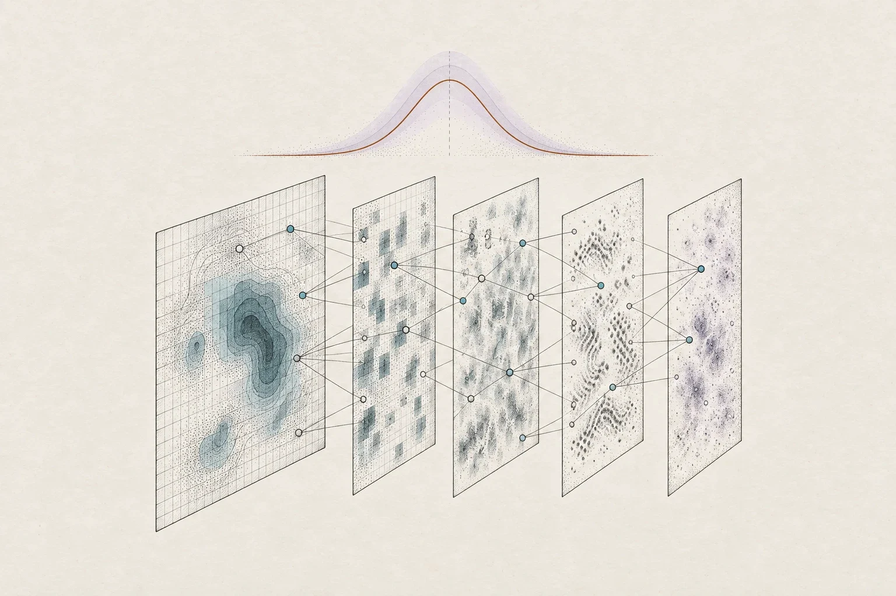
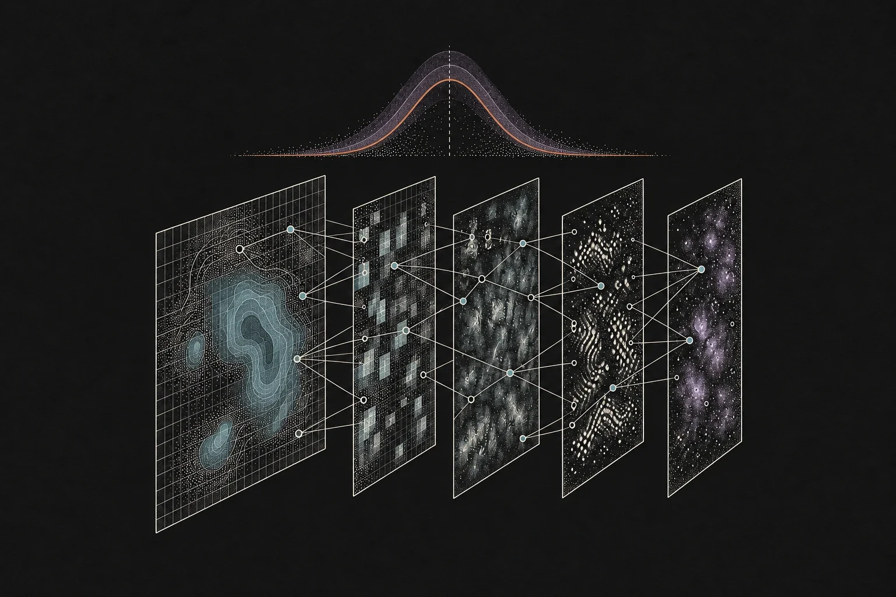
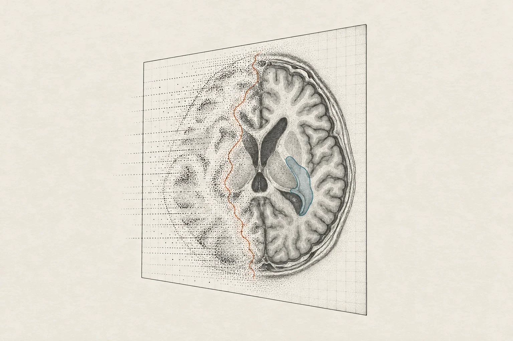
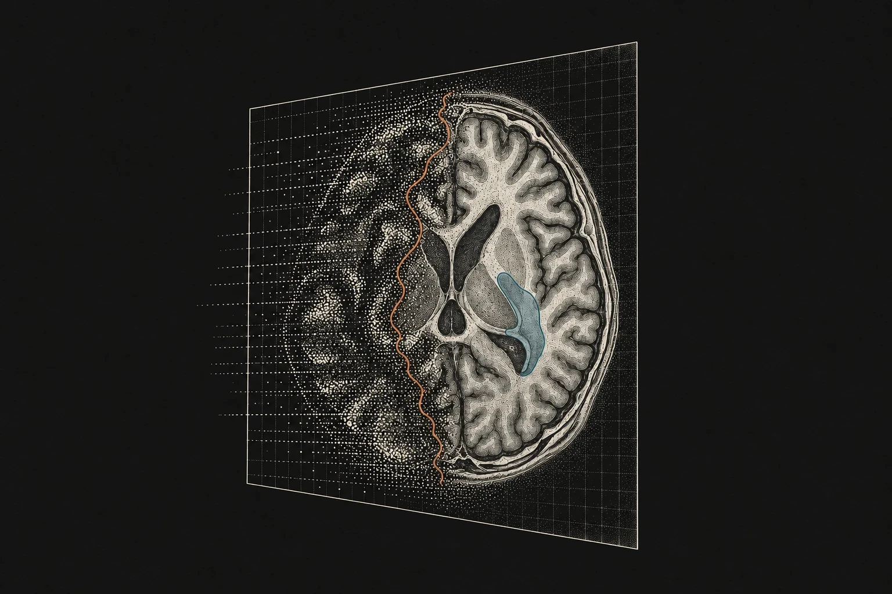
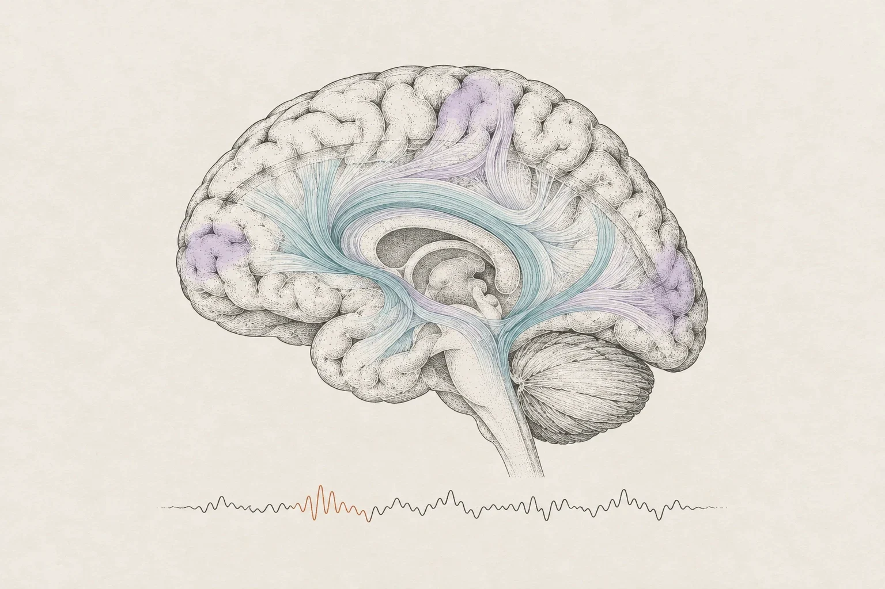
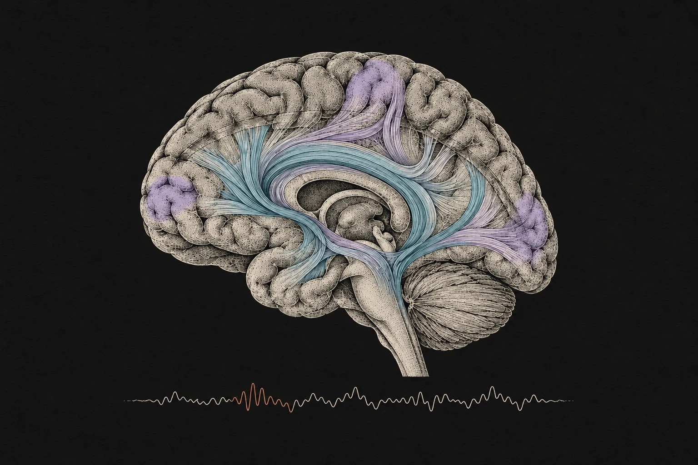

```{=html}
<section class="zl-hero" aria-label="Introduction">
  <div class="zl-hero__sticky">
    <div class="zl-hero__media" aria-hidden="true">
      
      
      
      
      <div class="zl-hero__veil"></div>
    </div>

    <div class="zl-hero__title">
      <p class="zl-eyebrow">Associate Professor &middot; Fudan University</p>
      <h1>Zeju Li<em>,</em> PhD</h1>
      <p class="zl-hero__role">Machine learning &times; medical imaging &mdash; computational tools for image reconstruction, brain function analysis and disease diagnosis.</p>
    </div>

    <ol class="zl-hero__chapters" aria-label="Research themes">
      <li><span>01</span><strong>Reliable AI</strong><em>interpretability &middot; uncertainty</em></li>
      <li><span>02</span><strong>Imaging pipelines</strong><em>reconstruction &middot; segmentation</em></li>
      <li><span>03</span><strong>Brain function</strong><em>fMRI &middot; dMRI</em></li>
    </ol>

    <div class="zl-hero__progress" aria-hidden="true"><span></span></div>
    <a class="zl-hero__cue" href="#about">Scroll</a>
  </div>
</section>
<script src="assets/js/hero.js"></script>
```

::: {.zl-home-body .column-page}

::: {.zl-split #about}
::: {.zl-split__head}
[About]{.zl-eyebrow}

We are pushing the boundaries of biomedical image analysis using AI.
:::

::: {.zl-split__body}
We are broadly interested in machine learning, medical imaging, and neuroimaging. Our research focuses on creating tools that enhance diagnostic accuracy and improve patient outcomes.

Currently, we are working on building AI models that can: 1) operate reliably and stably (e.g., interpretability, uncertainty), 2) advance medical imaging pipelines (e.g., reconstruction, segmentation), and 3) eventually enhance our understanding of brain functions (e.g., fMRI, dMRI).

[Learn more about me [→]{.zl-cta__arrow}](/about){.zl-cta}
:::
:::

```{=html}
<section class="zl-areas" aria-label="Research areas">
  <p class="zl-eyebrow">Research areas</p>
  <div class="zl-areas__grid">
    <article class="zl-area">
      <figure class="zl-area__fig"></figure>
      <div class="zl-area__meta"><span>01</span><span>Interpretability &middot; Uncertainty</span></div>
      <h3>Machine Learning</h3>
      <p>AI models that operate reliably and stably &mdash; and know when they might be wrong.</p>
    </article>
    <article class="zl-area">
      <figure class="zl-area__fig"></figure>
      <div class="zl-area__meta"><span>02</span><span>Reconstruction &middot; Segmentation</span></div>
      <h3>Medical Image Analysis</h3>
      <p>Advancing the imaging pipeline, from raw acquisition to clinically meaningful measurements.</p>
    </article>
    <article class="zl-area">
      <figure class="zl-area__fig"></figure>
      <div class="zl-area__meta"><span>03</span><span>fMRI &middot; dMRI</span></div>
      <h3>Computational Neuroscience</h3>
      <p>Modelling how the brain is wired and how it works, to deepen our understanding of brain function.</p>
    </article>
  </div>
</section>
```

::: {.zl-split}
::: {.zl-split__head}
[Latest]{.zl-eyebrow}

## Featured
:::

::: {.zl-split__body #featured-list}

:::
:::

::: {.zl-split}
::: {.zl-split__head}
[Join us]{.zl-eyebrow}

## Vacancies
:::

::: {.zl-split__body .zl-rows}
::: {.zl-row}
[Join Our Team](/vacancies.html)
[**Opportunities** Open positions]{.zl-row__meta}
:::

:::
:::

:::
